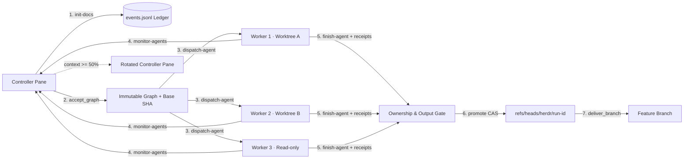

<div align="center">


# herdr-orchestrator

**Durable multi-agent orchestration from a single Herdr controller pane.**

*Dependency graphs, isolated Git worktrees, ownership gates, receipt-backed promotion, and seamless controller rotation — built on zero-dependency Python stdlib.*

[](package.json)
[](#requirements)
[](#install)
[](LICENSE)

[Quick Start](#quick-start) · [Why Herdr Orchestrator?](#why-herdr-orchestrator) · [Architecture](#how-it-works) · [Controller Operations](#controller-operations) · [Safety Invariants](#state-and-safety) · [Operator Contract](SKILL.md)

</div>

---

## What is `herdr-orchestrator`?

Running one coding agent is easy. Coordinating **five parallel agents** across a real repository without merge collisions, lost context, silent half-finished work, or runaway terminal panes is hard.

**`herdr-orchestrator`** turns one [Herdr](https://github.com/herdrdev/herdr) controller pane into a **fault-tolerant, event-sourced orchestrator** for AI coding workers. Herdr provides the terminal workspaces and agent lifecycle; `herdr-orchestrator` adds the missing control plane:

- **Event-sourced run ledger** — `events.jsonl` is the sole execution authority; crash or rotate the controller at any point and replay exact state.
- **Strict Git worktree isolation & ownership gates** — concurrent writers operate in separate worktrees with disjoint file ownership (`owns`), verified before anything is accepted.
- **Receipt-backed completion & CAS promotion** — workers cannot self-declare success; outputs are hashed, verified, and compare-and-swapped onto a run-owned ref without touching your primary branch.
- **Seamless controller rotation** — when the controller's context window fills (≥ 50% measured usage via the bundled OMP extension), hand off the lease to a fresh controller pane while workers keep running undisturbed.
- **Zero third-party dependencies** — pure Python 3 standard library (`fcntl`, `json`, `subprocess`) plus a lightweight TypeScript context exporter for OMP. No build step, no daemon, no database.

---

## Why Herdr Orchestrator?

| Capability | Single Agent Session | Ad-hoc Parallel Panes | Native Subagents (`task`) | **`herdr-orchestrator`** |
| :--- | :---: | :---: | :---: | :---: |
| Parallel multi-agent execution | — | Manual | Session-local | **Graph-scheduled** |
| Survives controller crash / context rotation | — | Manual | Lost on exit | **Reattach by identity** |
| Isolated Git worktrees per writer | — | Manual | Shared tree | **Automatic** |
| Disjoint file-ownership verification | — | — | — | **Enforced before finish** |
| Cryptographic artifact receipts & CAS promotion | — | — | — | **Built-in** |
| Safe retirement (never closes user panes) | — | — | N/A | **Guarded by ledger** |
| Zero external dependencies | — | — | — | **Python stdlib only** |

> `herdr-orchestrator` complements native `task`/`workflow` tools rather than replacing them — use native jobs for short session-local tasks, and `herdr-orchestrator` when work needs isolated worktrees, multi-wave dependency graphs, or durability across controller handoffs.

---

## How It Works



### Executors

| Executor | What it is |
| :--- | :--- |
| `herdr-agent` | A managed worker in an orchestrator-created workspace, with an isolated Git worktree for writers/integrators. Survives controller rotation and reattaches by recorded identity. |
| `pane` | An existing user-owned agent pane addressed via `prompt-agent.py`. Never retired by orchestration. |
| `task`, `workflow` | Bounded native harness jobs launched by the controller's harness. Session-local; cannot be reattached after controller exit. |

---

## Install

Install via OMP's plugin marketplace:

```sh
omp plugin marketplace add pallav10/herdr-orchestrator
omp plugin install herdr-orchestrator@pallav10
```

> **Note:** Installation defaults to user scope (all projects). Pass `--scope project` for a single project. Restart OMP after installation so the bundled context extension (`extensions/herdr-context.ts`) initializes. Use the marketplace route (OMP 18.10.1's direct Git installer does not discover root-level skills).

For a fresh Herdr setup, install its stock OMP lifecycle integration:

```sh
herdr integration install omp
```

<details>
<summary>Upgrading from a customized Herdr integration?</summary>

`herdr integration install omp` overwrites Herdr's managed integration file. Back up local changes first. If an older customized integration already exports context snapshots, migrate back to the stock lifecycle integration so only the bundled extension (`~/.omp/run/herdr-context`) writes context evidence.

</details>

---

## Quick Start

Run live orchestration commands from inside your Herdr controller pane (`HERDR_ENV=1`).

### 1. Gitignore runtime state in your target repository

```gitignore
/docs/sessions/
/docs/runs/
```

*(Initialization fails closed with exit code `3` if these paths are not gitignored.)*

### 2. Initialize a session and run

Use the unified front-door CLI **`scripts/ho.py`** — it auto-resolves `HERDR_WORKSPACE_ID`, `HERDR_PANE_ID`, canonical `session`/`run`, and current `epoch`:

```sh
HO="python3 scripts/ho.py"

$HO init --dir /abs/path/to/target-repo/docs --job my-feature
```

### 3. Accept a dependency graph (or render a template)

```sh
# Optional: render a built-in template and lint before accepting
python3 scripts/render-graph.py --template parallel-slices-integrate --out /tmp/graph.json
python3 scripts/validate-graph.py --graph-file /tmp/graph.json

$HO accept --graph /tmp/graph.json
```

Graph acceptance validates dependencies and file ownership, pins the repository `HEAD`, and initializes `refs/heads/herdr/<run-id>`.

### 4. Loop on `ho next` until `phase == "done"`

```sh
$HO next
```

`ho next` inspects replayed + live state and prints the exact copy-paste-ready commands for the next step:

- **Dispatch:** `$HO dispatch NODE --prompt-file FILE` (or `dispatch-wave.py` for critical-path ranked parallel waves and `run-script.py` for deterministic `script` nodes).
- **Monitor:** `$HO monitor` streams change-only JSONL with adaptive backoff (2s → 30s) until workers settle.
- **Verify:** `$HO finish NODE` checks Git cleanliness, file ownership (`check-ownership.py`), optional `verdict.json`, declared outputs, and SHA-256 receipts.
- **Promote:** `$HO promote NODE` auto-resolves `new_sha` from receipts, compare-and-swaps `refs/heads/herdr/<run-id>`, and delivers to a new feature branch without touching `main`.
- **Retire & Prune:** `$HO retire --all` closes eligible orchestrator-created workspaces; `prune-run.py` safely cleans up linked worktrees and run refs post-delivery.

---

## Controller Operations

Every adapter emits a single JSON object (or flushed JSONL for monitoring) and supports `--help` without touching Herdr, Git, or the ledger.

| Operation | Script / API | Responsibility |
| :--- | :--- | :--- |
| **Unified Loop** | `scripts/ho.py` | Single front-door CLI (`init`, `accept`, `next`, `dispatch`, `monitor`, `finish`, `promote`, `retire`, `status`) with auto-context |
| **Validate & Render** | `scripts/validate-graph.py`, `render-graph.py` | Offline Tarjan SCC cycle/overlap linter + parameterized templates (`references/templates/graphs/`) |
| **Wave & Script** | `scripts/dispatch-wave.py`, `run-script.py` | Critical-path/fan-out ranked wave dispatch + deterministic `script` executor |
| **Invalidate & Verdicts** | `scripts/invalidate-node.py`, `verdict.py` | Selective cascade send-back with `feedback.md`, structured `verdict.json`, rework stagnation guard |
| **Inspect & Doctor** | `scripts/inspect-run.py`, `doctor.py` | Read-only run timeline + next-action inspector; env/git/Herdr protocol preflight |
| **Metrics & Prune** | `scripts/run-metrics.py`, `prune-run.py` | Post-run wall/retry/token metrics (`metrics.json`) + fail-closed worktree/ref GC |
| **Rotate** | `scripts/rotate.py`, `ack-handoff.py` | Drain lease at ≥ 50% measured context usage and transfer epoch to successor |
| **Low-Level Adapters** | `init-docs.py`, `accept-graph.py`, `dispatch-agent.py`, `prompt-agent.py`, `monitor-agents.py`, `collect-agent.py`, `finish-agent.py`, `promote-run.py`, `retire-agents.py`, `reconcile.py` | Composable single-responsibility primitives underneath `ho.py` |

**Standard exit codes:** `0` success · `1` runtime failure · `2` usage/timeout · `3` refusal/findings · `4` `agent_blocked` (`prompt-agent.py`).

---

## State and Safety

```text
docs/
├── sessions/<id>/
│   ├── session.json              # Canonical run locator
│   ├── progress.md
│   ├── HANDOFF.md
│   └── NEXT-SESSION-PROMPT.md
└── runs/<run-id>/
    ├── run.json                  # Immutable run metadata & pinned base SHA
    ├── graph.json                # Accepted dependency graph
    ├── events.jsonl              # Sole execution authority (append-only)
    ├── graph-revisions/          # Immutable accepted graph payloads
    ├── artifacts/<node>/<n>/     # Prompts, logs, transcripts, hashed receipts
    ├── state.json                # Replay projection (cache)
    ├── controller.json           # Replay projection (cache)
    ├── status.md                 # Human-readable status projection
    └── run.lock                  # POSIX fcntl lock (--lock-timeout, default 120s)
```

### Core Invariants

1. **Ledger is authority** — `events.jsonl` is the single source of truth. Never mutate `state.json`, `controller.json`, or Herdr `idle`/`done` status to declare completion.
2. **Exact-holder authorization** — mutations require the exact `(workspace, pane, session)` holder triple and replayed `epoch`, never window focus or labels.
3. **Disjoint writer ownership** — concurrent writers must declare non-overlapping `owns` globs; overlapping work is serialized by the graph.
4. **Never close user surfaces** — `retire-agents.py` refuses to close panes the orchestrator did not create, and never stops the Herdr server.
5. **Single-submit prompt delivery** — `herdr_cli.deliver_prompt` submits prompt text once with `--wait --until working` and never double-submits text on retry.

---

## Detached Self-Improvement

Found an edge case or bug during a live run? Queue an isolated fix without disrupting the active run:

```sh
python3 scripts/self-improve.py \
  --skill-repo /absolute/path/to/herdr-orchestrator \
  --finding "Observed issue; evidence; bounded change; acceptance check"
```

The launcher clones `HEAD` into `~/.omp/run/herdr-improvements/<job>/checkout`, strips `origin`, and runs a no-focus worker that outputs `change.patch` and `result.json` for review — leaving the source checkout, installed skill, and active run untouched.

---

## Requirements

- **Python 3** (standard library only; POSIX required for `fcntl` locking)
- **`git`** on `PATH` and a target Git repository
- **`herdr`** on `PATH` (checked against Herdr **0.9.3 / protocol 22**) and worker CLI (default: `omp`)
- **OMP 18.10.1+** with `ExtensionContext.getContextUsage()` for measured controller rotation

---

## Development & Testing

Run the stdlib test suite directly — no virtual environment or dependency install needed:

```sh
python3 -m unittest discover -s scripts -p 'test_*.py'
python3 -m unittest discover -s scripts -p 'test_run_state.py'
python3 scripts/prompt_contract.py
```

<details>
<summary>Repository layout & module boundaries</summary>

| Path | Responsibility |
| :--- | :--- |
| [SKILL.md](SKILL.md) | Operator contract and step-by-step orchestration loop |
| [references/](references/) | Session docs, playbook, identity/reattach, rotation, retire/promote, run-state API |
| [scripts/run_state.py](scripts/run_state.py) | Stable controller-facing import facade |
| [scripts/ledger.py](scripts/ledger.py), [scripts/authz.py](scripts/authz.py) | Event/revision validation, replay, receipt verification, locks, holder guards |
| [scripts/graph_model.py](scripts/graph_model.py), [scripts/ownership.py](scripts/ownership.py) | Graph/identity schema and path-ownership classification |
| [scripts/promotion.py](scripts/promotion.py), [scripts/scheduler.py](scripts/scheduler.py) | CAS promotion, create-only branch delivery, lifecycle reconciliation |
| [scripts/herdr_cli.py](scripts/herdr_cli.py), [scripts/ioutil.py](scripts/ioutil.py) | Atomic I/O, deadline-bound Git, Herdr subprocess/prompt boundary |
| [extensions/herdr-context.ts](extensions/herdr-context.ts) | Native main-UI OMP context usage exporter for the rotation gate |
| [docs/diagrams/](docs/diagrams/) | Interactive visual diagrams of the orchestration loop |

</details>

---

## License

[MIT](LICENSE) © [Pallav Parikh](https://github.com/pallav10)
