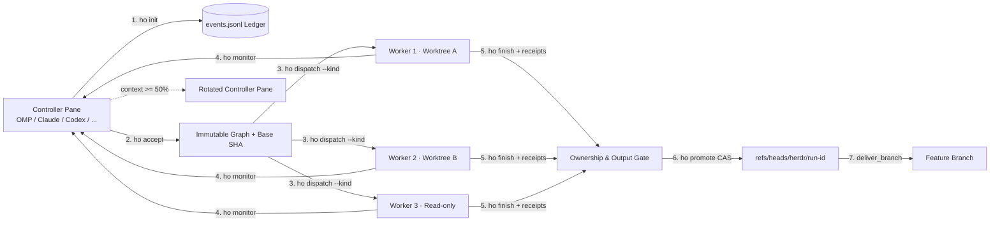

<div align="center">


# herdr-orchestrator

**Durable, harness-agnostic multi-agent orchestration from a single Herdr controller pane.**

*Dependency graphs, isolated Git worktrees, ownership gates, receipt-backed promotion, and seamless controller rotation across **OMP, Claude Code, Codex, Copilot CLI, Pi, Grok Build**, and custom CLI harnesses — built on zero-dependency Python stdlib.*

[](package.json)
[](#requirements)
[](#supported-harnesses)
[-8B5CF6?style=flat-square)](#requirements)
[](LICENSE)

[Supported Harnesses](#supported-harnesses) · [Install](#install) · [Quick Start](#quick-start) · [Architecture](#how-it-works) · [Controller Operations](#controller-operations) · [Safety Invariants](#state-and-safety) · [Operator Contract](SKILL.md)

</div>

---

## What is `herdr-orchestrator`?

Running one coding agent is easy. Coordinating **five parallel agents** across a real repository — potentially mixing Claude Code, Codex, and OMP workers — without merge collisions, lost context, silent half-finished work, or runaway terminal panes is hard.

**`herdr-orchestrator`** turns one [Herdr](https://github.com/herdrdev/herdr) (or `herdr-core` / `hc`) controller pane into a **fault-tolerant, event-sourced control plane** for AI coding workers:

- **Harness-agnostic by design** — run any supported CLI harness as controller or worker, even mixing harnesses per node in the same `graph.json`.
- **Per-run SQLite WAL ledger & zero repo pollution** — state lives under `${XDG_STATE_HOME:-~/.local/state}/herdr-orchestrator/` (`run.db` + content-addressed `blobs/` + rebuildable `index.db`). Zero `.gitignore` edits, zero `.md` handoff files, works seamlessly across Git worktrees.
- **Isolated Git worktrees & ownership gates** — concurrent writers operate in separate worktrees with disjoint `owns` globs, verified before anything is accepted.
- **Receipt-backed completion & CAS promotion** — workers cannot self-declare success; outputs are hashed, verified, and compare-and-swapped onto a run-owned ref without touching your primary branch.
- **Seamless zero-markdown controller rotation** — record structured notes (`ho note add`) in `run.db`; when context occupancy reaches ≥ 50%, `ho rotate --focus "..."` drains the lease and synthesizes the successor prompt dynamically from the ledger.
- **Zero third-party dependencies** — pure Python 3 standard library (`sqlite3`, `fcntl`, `json`, `subprocess`). No build step, no daemon.
---

## Why Herdr Orchestrator?

| Capability | Single Agent | Ad-hoc Panes | Native Subagents (`task`) | **`herdr-orchestrator`** |
| :--- | :---: | :---: | :---: | :---: |
| Parallel multi-agent execution | — | Manual | Session-local | **Graph-scheduled** |
| Mix harnesses in one run | — | Manual | Single harness | **Per-node `kind`** |
| Survives controller crash / rotation | — | Manual | Lost on exit | **Reattach by identity** |
| Isolated Git worktrees per writer | — | Manual | Shared tree | **Automatic** |
| Disjoint file-ownership verification | — | — | — | **Enforced before finish** |
| Cryptographic receipts & CAS promotion | — | — | — | **Built-in** |
| Safe retirement (never closes user panes) | — | — | N/A | **Guarded by ledger** |
| Zero external dependencies | — | — | — | **Python stdlib only** |

> `herdr-orchestrator` complements native `task`/`workflow` subagents rather than replacing them — use native jobs for short session-local slices, and `herdr-orchestrator` when work needs isolated worktrees, multi-wave dependency graphs, cross-harness execution, or durability across controller handoffs.

---

## Supported Harnesses

Worker harness selection resolves in deterministic precedence order:

```text
--kind flag  →  node.kind (graph.json)  →  graph.default_kind  →  $HERDR_ORCHESTRATOR_KIND  →  omp
```

| Harness | Accepted `--kind` Aliases | Model & Reasoning Flags | Role Lookup (`--model-role`) | Context Rotation Hook |
| :--- | :--- | :--- | :--- | :--- |
| **OMP** | `omp`, `oh-my-pi` | `--model provider/id` `--thinking <lvl>` | `omp config get modelRoles --json` | `extensions/herdr-context.ts` |
| **Claude Code** | `claude`, `claude-code` | `--model <alias\|id>` `--effort <lvl>` | `~/.config/herdr-orchestrator/roles.json` | `scripts/claude-context-hook.py` |
| **Codex** | `codex`, `openai-codex` | `-m <id>` `-c model_reasoning_effort=<lvl>` | `~/.config/herdr-orchestrator/roles.json` | Manual / JSONL metrics |
| **Copilot CLI** | `copilot`, `copilot-cli`, `github-copilot` | `--model <id>` `--reasoning-effort <lvl>` | `~/.config/herdr-orchestrator/roles.json` | Manual |
| **Pi** | `pi` | `--model <pattern>` `--thinking <lvl>` | `~/.config/herdr-orchestrator/roles.json` | Pi extension API |
| **Grok Build** | `grok`, `grok-build` | `--model <id>` | `~/.config/herdr-orchestrator/roles.json` | Manual |
| **Custom CLI** | Any executable on `PATH` | `--model <id>` | `~/.config/herdr-orchestrator/roles.json` | Schema v2 snapshot |

<details>
<summary>Optional: Configure logical model roles for non-OMP harnesses (<code>roles.json</code>)</summary>

Create `~/.config/herdr-orchestrator/roles.json` (or `$XDG_CONFIG_HOME/herdr-orchestrator/roles.json`) to use `--model-role default|slow|smol` across harnesses:

```json
{
  "claude": { "default": "sonnet", "slow": "opus", "smol": "haiku" },
  "codex": { "default": "o3", "smol": "o4-mini" },
  "copilot": { "default": "gpt-5" },
  "pi": { "default": "anthropic/claude-sonnet-4-6" },
  "grok": { "default": "grok-4" }
}
```

You can always bypass roles and pass `--model <id>` directly on any dispatch.

</details>

---

## Install

### OMP (Plugin Marketplace)

```sh
omp plugin marketplace add pallav10/herdr-orchestrator
omp plugin install herdr-orchestrator@pallav10
```

> Restart OMP after installation so `extensions/herdr-context.ts` loads. For legacy Herdr, also run `herdr integration install omp`.

### Claude Code (Plugin Marketplace)

```sh
claude plugin marketplace add pallav10/herdr-orchestrator
claude plugin install herdr-orchestrator@pallav10
```

<details>
<summary>Optional: Enable measured context rotation in Claude Code</summary>

Wire `scripts/claude-context-hook.py` into your Claude Code `statusLine` or `Stop` hook so it writes atomic schema v2 context snapshots to `~/.local/state/herdr-orchestrator/context/`.

</details>

### Codex · Copilot CLI · Pi · Grok Build (Agent Skill)

Clone the repository into your harness's skills directory (the root `SKILL.md` follows the Agent Skills standard):

```sh
# Codex
git clone https://github.com/pallav10/herdr-orchestrator.git ~/.codex/skills/herdr-orchestrator

# Copilot CLI (project-local)
git clone https://github.com/pallav10/herdr-orchestrator.git .github/skills/herdr-orchestrator

# Generic / shared path
git clone https://github.com/pallav10/herdr-orchestrator.git ~/.local/share/herdr-orchestrator
export HERDR_ORCHESTRATOR_KIND=codex   # or claude | copilot | pi | grok
```

Verify your environment at any time with:

```sh
python3 scripts/doctor.py
```

---

## Quick Start

Run live orchestration commands from inside a Herdr controller pane (`HERDR_ENV=1` for legacy Herdr, or `HC_TERMINAL_ID` for `herdr-core`).

### 1. Initialize a run (zero `.gitignore` needed)

Use the unified front-door CLI **`scripts/ho.py`** — it stores state in `${XDG_STATE_HOME:-~/.local/state}/herdr-orchestrator/runs/<run-id>/run.db` (overridable via `HERDR_ORCHESTRATOR_STATE_DIR`) and auto-resolves legacy Herdr (`HERDR_WORKSPACE_ID`/`HERDR_PANE_ID`) or `herdr-core` (`HC_TERMINAL_ID`), active run, and current `epoch` via `index.db`:

```sh
HO="python3 /abs/path/to/herdr-orchestrator/scripts/ho.py"

$HO init --job my-feature
```

### 2. Accept a dependency graph

Render a built-in template, optionally pin `default_kind` or per-node `kind`, lint it, and accept:

```sh
python3 scripts/render-graph.py --template parallel-slices-integrate --out /tmp/graph.json
python3 scripts/validate-graph.py --graph-file /tmp/graph.json

$HO accept --graph /tmp/graph.json
```

Graph acceptance validates dependencies and file ownership, pins the repository `HEAD`, and initializes `refs/heads/herdr/<run-id>`.

### 3. Loop on `ho next` until `phase == "done"`

```sh
$HO next
```

`ho next` inspects replayed + live state and returns exact copy-paste-ready commands for the next step:

- **Dispatch:** `$HO dispatch NODE --prompt-file FILE [--kind claude|codex|omp|...] [--model M] [--requested-effort high]`
- **Monitor:** `$HO monitor` streams change-only JSONL with adaptive backoff (2s → 30s) until workers settle.
- **Verify:** `$HO finish NODE` checks Git cleanliness, file ownership (`check-ownership.py`), optional `verdict.json`, declared outputs, and SHA-256 receipts.
- **Promote:** `$HO promote NODE` auto-resolves `new_sha` from receipts, compare-and-swaps `refs/heads/herdr/<run-id>`, and delivers to a new feature branch without touching `main`.
- **Retire & Prune:** `$HO retire --all` closes eligible orchestrator-created workspaces; `prune-run.py` cleans up linked worktrees and run refs post-delivery.

---

## How It Works



### Executors

| Executor | What it is |
| :--- | :--- |
| `herdr-agent` | Managed worker in an orchestrator-created workspace (any harness via `kind`), with an isolated Git worktree for writers/integrators. Survives controller rotation and reattaches by recorded identity. |
| `script` | Deterministic local command runner (`run-script.py`) for builds, linters, and test gates inside the graph. |
| `pane` | Existing user-owned agent pane addressed via `prompt-agent.py`. Never retired by orchestration. |
| `task`, `workflow` | Bounded native harness jobs launched by the controller's harness. Session-local; cannot be reattached after controller exit. |

---

## Controller Operations

Every adapter emits a single JSON object (or flushed JSONL for monitoring) and supports `--help` without touching Herdr, Git, or the ledger.

| Operation | Script | Responsibility |
| :--- | :--- | :--- |
| **Unified Loop** | `scripts/ho.py` | Front-door CLI (`init`, `accept`, `next`, `dispatch`, `monitor`, `finish`, `promote`, `retire`, `status`, `note`, `brief`, `rotate`, `ack`) with XDG `index.db` auto-context |
| **Storage Engine** | `scripts/state_paths.py`, `run_store.py` | XDG state root, rebuildable `index.db`, per-run SQLite WAL `run.db`, content-addressed `blobs/`, dynamic brief synthesis |
| **Harness Registry** | `scripts/harnesses.py` | Canonical aliases, per-harness CLI flags, role lookup, process matching, and XDG state paths |
| **Validate & Render** | `scripts/validate-graph.py`, `render-graph.py` | Offline Tarjan SCC cycle/overlap linter + parameterized templates (`references/templates/graphs/`) |
| **Wave & Script** | `scripts/dispatch-wave.py`, `run-script.py` | Critical-path/fan-out ranked wave dispatch + deterministic `script` executor |
| **Invalidate & Verdicts** | `scripts/invalidate-node.py`, `verdict.py` | Selective cascade send-back with `feedback.md`, structured `verdict.json`, rework stagnation guard |
| **Inspect & Doctor** | `scripts/inspect-run.py`, `doctor.py` | Read-only run timeline + next-action inspector; env/git/Herdr/harness preflight |
| **Metrics & Prune** | `scripts/run-metrics.py`, `prune-run.py` | Post-run wall/retry/token metrics (`metrics.json`) across OMP/Claude/Codex JSONL + fail-closed worktree/ref GC |
| **Rotate** | `scripts/rotate.py`, `ack-handoff.py` | Drain lease at ≥ 50% measured context usage and transfer epoch to successor |
| **Low-Level Adapters** | `accept-graph.py`, `dispatch-agent.py`, `spawn-agent.py`, `prompt-agent.py`, `monitor-agents.py`, `collect-agent.py`, `finish-agent.py`, `promote-run.py`, `retire-agents.py`, `reconcile.py` | Composable single-responsibility primitives underneath `ho.py` |

**Standard exit codes:** `0` success · `1` runtime failure · `2` usage/timeout · `3` refusal/findings · `4` `agent_blocked` (`prompt-agent.py`).

---

## State and Safety

```text
${XDG_STATE_HOME:-~/.local/state}/herdr-orchestrator/
├── context/                      # Measured context snapshots (OMP / Claude Code)
├── index.db                      # Rebuildable SQLite WAL lookup: (ws, pane) -> active run
└── runs/<run-id>/
    ├── run.db                    # Authoritative SQLite WAL store (events, state, controller, revisions, notes)
    ├── run.lock                  # POSIX fcntl lock strictly for external side-effect sections (herdr/git)
    ├── blobs/<sha256>            # Write-once content-addressed payloads (prompts, diffs, transcripts)
    └── artifacts/<node>/<n>/     # Per-attempt receipts and dispatch identities
```

### Core Invariants

1. **Ledger is authority** — `events.jsonl` is the single source of truth. Never mutate `state.json`, `controller.json`, or Herdr `idle`/`done` status to declare completion.
2. **Exact-holder authorization** — mutations require the exact `(workspace, pane, session)` holder triple and replayed `epoch`, never window focus or labels.
3. **Disjoint writer ownership** — concurrent writers must declare non-overlapping `owns` globs; overlapping work is serialized by the graph.
4. **Never close user surfaces** — `retire-agents.py` refuses to close panes the orchestrator did not create, and never stops the Herdr server.
5. **Single-submit prompt delivery** — `herdr_cli.deliver_prompt` submits prompt text once with `--wait --until working` and never double-submits text on retry.

---

## Detached Self-Improvement

Found an edge case or bug during a live run? Queue an isolated fix without disrupting the active run:

```sh
python3 scripts/self-improve.py \
  --skill-repo /absolute/path/to/herdr-orchestrator \
  --kind claude \
  --finding "Observed issue; evidence; bounded change; acceptance check"
```

The launcher clones `HEAD` into `~/.local/state/herdr-orchestrator/improvements/<job>/checkout`, strips `origin`, and runs a no-focus worker that outputs `change.patch` and `result.json` for review — leaving the source checkout, installed skill, and active run untouched.

---

## Requirements

- **Python 3** (standard library only; POSIX required for `fcntl` locking)
- **`git`** on `PATH` and a target Git repository
- **`herdr`** (0.9.3 / protocol 22) or **`herdr-core` (`hc`)** on `PATH`
- One or more supported agent CLIs on `PATH`: `omp`, `claude`, `codex`, `copilot`, `pi`, `grok` (or any custom CLI)
- For measured controller rotation: OMP (`extensions/herdr-context.ts`) or Claude Code (`scripts/claude-context-hook.py`)

---

## Development & Testing

Run the stdlib test suite directly — no virtual environment or dependency install needed:

```sh
python3 -m unittest discover -s scripts -p 'test_*.py'
python3 -m unittest discover -s scripts -p 'test_harnesses.py'
python3 scripts/prompt_contract.py
```

<details>
<summary>Repository layout & module boundaries</summary>

| Path | Responsibility |
| :--- | :--- |
| [SKILL.md](SKILL.md) | Operator contract and 4-step `ho.py` orchestration loop |
| [references/](references/) | Session docs, playbook, identity/reattach, rotation, retire/promote, run-state API |
| [scripts/harnesses.py](scripts/harnesses.py) | Multi-harness registry, CLI flag translation, role lookup, process matching, XDG paths |
| [scripts/run_state.py](scripts/run_state.py) | Stable controller-facing import facade |
| [scripts/ledger.py](scripts/ledger.py), [scripts/authz.py](scripts/authz.py) | Event/revision validation, replay, receipt verification, locks, holder guards |
| [scripts/graph_model.py](scripts/graph_model.py), [scripts/ownership.py](scripts/ownership.py) | Graph/identity schema and path-ownership classification |
| [scripts/promotion.py](scripts/promotion.py), [scripts/scheduler.py](scripts/scheduler.py) | CAS promotion, create-only branch delivery, lifecycle reconciliation |
| [scripts/herdr_cli.py](scripts/herdr_cli.py), [scripts/ioutil.py](scripts/ioutil.py) | Atomic I/O, deadline-bound Git, `herdr` & `herdr-core` (`hc`) boundary |
| [extensions/herdr-context.ts](extensions/herdr-context.ts) | Native main-UI OMP context usage exporter for the rotation gate |
| [scripts/claude-context-hook.py](scripts/claude-context-hook.py) | Claude Code hook producer for schema v2 context snapshots |
| [.omp-plugin/](.omp-plugin/), [.claude-plugin/](.claude-plugin/) | Plugin marketplace manifests for OMP and Claude Code |
| [docs/diagrams/](docs/diagrams/) | Interactive visual diagrams of the orchestration loop |

</details>

---

## License

[MIT](LICENSE) © [Pallav Parikh](https://github.com/pallav10)
